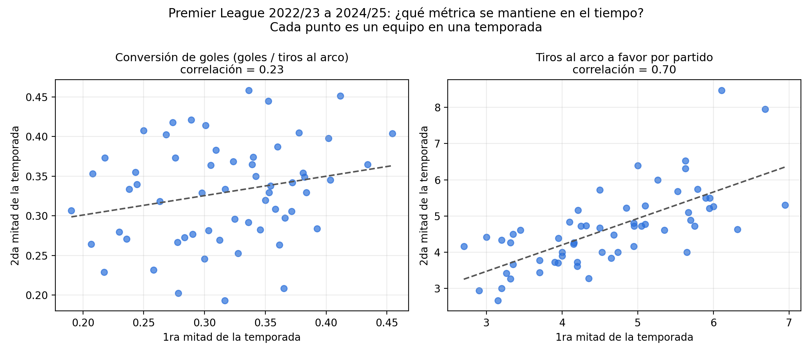
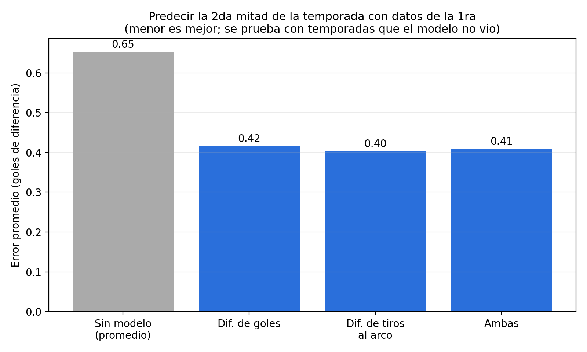

# ¿Qué métricas de fútbol son estables y cuáles son ruido?

Análisis de 3 temporadas de la Premier League (2022/23 a 2024/25) para
identificar qué indicadores de rendimiento se mantienen en el tiempo y
cuáles dependen en gran parte de la suerte.

## Problema

Evaluar a un equipo por sus últimos resultados puede llevar a decisiones
equivocadas si esos resultados son en parte azar. La pregunta: ¿en qué
métricas conviene confiar para anticipar el rendimiento futuro?

## Método

- **Datos:** 1.140 partidos (3 temporadas), fuente pública Football-Data.co.uk.
- Cada temporada se divide en dos mitades por fecha. Cada equipo se mide en
  ambas (local y visitante, unos 19-20 partidos por mitad).
- **Estabilidad:** se compara cada métrica de la 1ra mitad con la 2da.
- **Modelo:** regresión lineal que predice la diferencia de goles de la 2da
  mitad con datos de la 1ra. Se valida entrenando con dos temporadas y
  probando con la tercera, que el modelo no vio.

## Resultados

| Métrica | Correlación 1ra vs. 2da mitad |
|---|---|
| Tiros al arco a favor (por partido) | 0.70 |
| Tiros al arco en contra (por partido) | 0.68 |
| Conversión de goles (goles / tiros al arco) | 0.23 |

| Modelo | Error promedio (goles) | Mejora vs. línea base |
|---|---|---|
| Sin modelo (promedio) | 0.65 | — |
| Diferencia de goles | 0.42 | 36% |
| Diferencia de tiros al arco | 0.40 | 38% |
| Ambas | 0.41 | 37% |

## Conclusiones

- El volumen de tiros se mantiene bastante más que la eficiencia de
  definición, que fluctúa mucho entre mitades.
- La conversión de goles no es ruido puro (0.23), pero es poco confiable:
  en 2024/25 casi no se mantuvo (0.04) y en las otras dos temporadas sí (~0.3).
- Los tiros y los goles predicen casi igual de bien. La ventaja de los
  tiros es chica, así que no se la puede afirmar con este volumen de datos.

## Limitaciones

- Una sola liga y 3 temporadas (60 equipos-temporada). Las correlaciones
  tienen un margen de error considerable.
- Un mismo equipo aparece hasta tres veces, así que las filas no son
  completamente independientes.
- Se usan tiros al arco, no la calidad de las ocasiones (xG).
- Es un análisis descriptivo: no demuestra causas.

## Próximos pasos

- Agregar otras ligas y más temporadas.
- Incorporar métricas de calidad de ocasiones.
- Convertirlo en un informe automático de rival para cuerpos técnicos.

## Cómo reproducirlo

1. Instalar las librerías: `pip install pandas numpy scikit-learn matplotlib`
2. Descargar los CSV de cada temporada de la Premier League desde
   [Football-Data.co.uk](https://www.football-data.co.uk/englandm.php) y
   guardarlos en la misma carpeta que el script. Los datos no se incluyen
   en este repositorio.
3. Abrir `analisis_premier.py`, ajustar los nombres de archivo en el
   diccionario `ARCHIVOS` y ejecutarlo. Genera `grafico_estabilidad.png` y
   `grafico_modelos.png` en la misma carpeta.

## Fuente de los datos

Football-Data.co.uk (resultados y estadísticas de partidos). Consultar sus
términos de uso antes de redistribuir los datos.
